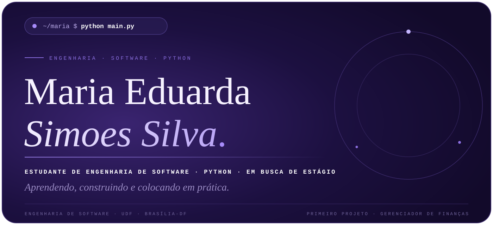

 

 

## Sobre mim

Sou estudante de Engenharia de Software na UDF, em Brasília-DF. Estou aprendendo lógica de programação e Python, e busco meu primeiro estágio em TI para colocar o que aprendo em prática.

## Tecnologias

- **Python**: variáveis, condicionais, laços de repetição e arquivos JSON
- **Git e GitHub**: commits, push e versionamento dos meus projetos

## Projetos

**[Gerenciador de finanças pessoais](https://github.com/duda670/gerenciador-financas-python)**
Meu primeiro projeto em Python. Roda no terminal, cadastra receitas e despesas, mostra o saldo e o total por categoria, e salva os dados em JSON.
